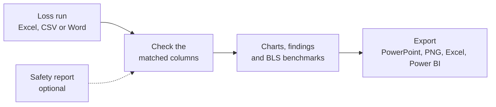

# Loss Dashboard

Free loss run dashboard for risk and safety teams. Drop in a loss run, get charts, findings, BLS safety benchmarks and a PowerPoint. One HTML file that runs offline.

https://github.com/user-attachments/assets/51d1eb1e-33a6-48a0-933a-5353ef67526d

A 60-second introduction to Loss Dashboard. Everything shown is synthetic sample data.

[Download the dashboard](#download) · [Watch the tutorials](#video-tutorials)

## Download

No GitHub account, install or sign-up needed. Click a link and the file downloads.

| Download | What it is |
|---|---|
| [Loss Dashboard (offline).html](https://github.com/Raxa-Personal-Hobby/loss-dashboard/releases/latest/download/Loss-Dashboard-offline.html) | The dashboard. Save it anywhere, then double-click to open it in Chrome or Edge. Works with Wi-Fi off. |
| [Quick Start Guide (PDF)](https://github.com/Raxa-Personal-Hobby/loss-dashboard/releases/latest/download/Loss-Dashboard-Quick-Start-Guide.pdf) | How to use it, step by step. Ready to print. |
| [Both in one zip](https://github.com/Raxa-Personal-Hobby/loss-dashboard/releases/latest/download/Loss-Dashboard-offline.zip) | The dashboard and the guide together. On Windows, right-click the zip and pick Extract All first. |

## Video tutorials

Watch these step-by-step guides here, or download the MP4 files to watch offline. Everything shown is synthetic sample data.

### 1. Upload your reports

https://github.com/user-attachments/assets/3e90c550-f8fc-4ec7-b621-bea2a589135e

[Download the upload tutorial (MP4)](https://github.com/Raxa-Personal-Hobby/loss-dashboard/releases/download/v1.2.1/Loss-Dashboard-howto-upload.mp4)

### 2. Add a safety report

https://github.com/user-attachments/assets/02de6aec-57a5-4583-b1a2-fc55d33edff2

[Download the safety report tutorial (MP4)](https://github.com/Raxa-Personal-Hobby/loss-dashboard/releases/download/v1.2.1/Loss-Dashboard-howto-safety-report.mp4)

### 3. Export your results

https://github.com/user-attachments/assets/6485868a-1d92-4092-8e48-d39f567f524e

[Download the export tutorial (MP4)](https://github.com/Raxa-Personal-Hobby/loss-dashboard/releases/download/v1.2.1/Loss-Dashboard-howto-export.mp4)

## How it works

| Feature | What you get |
|---|---|
| Any industry | Type a NAICS code or plain words ("roofing", "senior living"). It picks the template (restaurant, construction, fleet, real estate or general) and the BLS benchmark. |
| Findings | Plain-language findings from fixed rules and math on your data. No AI writes them. |
| Sourced guidance | Each finding links to public guidance from OSHA, NIOSH, CDC, FMCSA and other agencies. Full list in [GUIDANCE.md](GUIDANCE.md). |
| Safety rates | Add OSHA columns and hours worked and it works out TRIR, DART, days-away and severity rates next to the BLS average. |
| Safety report merge | Add an OSHA 300 log, OSHA's injury tracking (ITA) CSV or your own safety sheet. A blank template is included. Locations are matched for you, and you confirm every pair before anything is combined. |
| Your branding | Add your logo and colors. Palettes are checked for color-blind readability. |
| Exports | PowerPoint deck, PNG charts, Excel with the filtered claims, and a Power BI data model. See [POWER-BI.md](POWER-BI.md). |

## Your data stays on your computer

- No server. Files are never uploaded.
- The offline file blocks every web request, so it works with Wi-Fi off.
- All sample data is synthetic, generated in the browser from fixed seeds. See [PROVENANCE.md](PROVENANCE.md).

It's general information, not legal, safety or insurance advice.

## What's new

v1.4.0 (Nov 2026): the upload window reads the as-of date printed on your loss run and asks you to confirm it before the dashboard is built. If the loss run doesn't state one, it offers the latest date in the file. Click the Valued date at the top of the dashboard to change it later without uploading again.

v1.3.1 (Nov 2026): construction template only. Coverage lines are sorted into general liability by standard liability wording, and the benchmark label now reads "general contractor".

v1.3.0 (Nov 2026): export a Power BI data model, one Excel file with seven tables whose names and columns stay the same every month, so a Power BI, Tableau or Excel report refreshes without rework. There's also a command for scheduled refreshes that needs no browser. See [POWER-BI.md](POWER-BI.md). Claim descriptions in the Excel exports now show `[claimant]` in place of the claimant's name.

v1.2.3 (Nov 2026): retail and information NAICS codes now find the right 2025 benchmark. BLS moved to 2022 NAICS codes this year, so older 2017 codes (446110 for a pharmacy) are matched to the new ones (456110).

v1.2.2 (Nov 2026): safety benchmarks are the BLS 2025 rates, published November 18, 2026.

v1.2.1 (Nov 2026): one Upload source data window for the loss run and a safety report, with blank templates for both. Reads OSHA's injury tracking (ITA) CSV and OSHA 300 logs typed into Excel, and stops with a message if a safety report's OSHA columns can't be read. Your industry and NAICS code now show in the sidebar, there's an Export reports section, and a short "What's new" note appears when you open a new version. Sample companies are now named Acme, and the Quick Start Guide is updated.

v1.2.0 (Nov 2026): combine a safety report with your loss run. Add your own safety sheet, or an OSHA 300 log with a case type column, and it's joined to the loss run by location and year. Location names are matched even when the two reports write them differently, and four new findings compare both reports.

v1.1.1: every finding shows a short summary of public guidance with a link to its source.

All releases: [Releases page](https://github.com/Raxa-Personal-Hobby/loss-dashboard/releases).

## For developers

Build steps, the file map, how findings and benchmarks work, and how to add an industry are in [DEVELOPERS.md](DEVELOPERS.md).

## About

A portfolio project by Daniel Raxa, built to show risk management and loss analysis skills. It's free and open source. There's no paid version and nothing here is for sale.

## License

MIT, so anyone can use, share or change it. See [LICENSE](LICENSE).
