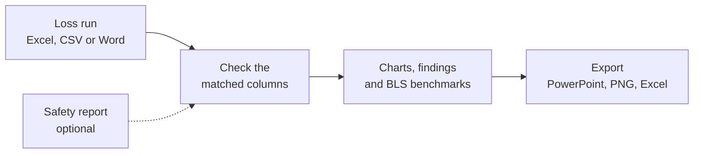

# Loss Dashboard

Free loss run dashboard for risk and safety teams. Drop in a loss run, get charts, findings, BLS safety benchmarks and a PowerPoint. One HTML file that runs offline.

https://github.com/user-attachments/assets/064c8119-6c20-4382-b5a8-569a9f6cd001

A 90 second walkthrough. Everything shown is synthetic sample data.

## Download

No GitHub account, install or sign-up needed. Click a link and the file downloads.

| Download | What it is |
|---|---|
| [Loss Dashboard (offline).html](https://github.com/Raxa-Personal-Hobby/loss-dashboard/releases/latest/download/Loss-Dashboard-offline.html) | The dashboard. Save it anywhere, then double-click to open it in Chrome or Edge. Works with Wi-Fi off. |
| [Quick Start Guide (PDF)](https://github.com/Raxa-Personal-Hobby/loss-dashboard/releases/latest/download/Loss-Dashboard-Quick-Start-Guide.pdf) | How to use it, step by step. Ready to print. |
| [Both in one zip](https://github.com/Raxa-Personal-Hobby/loss-dashboard/releases/latest/download/Loss-Dashboard-offline.zip) | The dashboard and the guide together. On Windows, right-click the zip and pick Extract All first. |

## How it works

| Feature | What you get |
|---|---|
| Any industry | Type a NAICS code or plain words ("roofing", "senior living"). It picks the template (restaurant, construction, fleet, real estate or general) and the BLS benchmark. |
| Findings | Plain-language findings from fixed rules and math on your data. No AI writes them. |
| Sourced guidance | Each finding links to public guidance from OSHA, NIOSH, CDC, FMCSA and other agencies. Full list in [GUIDANCE.md](GUIDANCE.md). |
| Safety rates | Add OSHA columns and hours worked and it works out TRIR, DART, days-away and severity rates next to the BLS average. |
| Safety report merge | Add an OSHA 300 log export. Locations are matched for you, and you confirm every pair before anything is combined. |
| Your branding | Add your logo and colors. Palettes are checked for color-blind readability. |
| Exports | PowerPoint deck, PNG charts, and Excel with the filtered claims. |

## Your data stays on your computer

- No server. Files are never uploaded.
- The offline file blocks every web request, so it works with Wi-Fi off.
- All sample data is synthetic, generated in the browser from fixed seeds. See [PROVENANCE.md](PROVENANCE.md).

It's general information, not legal, safety or insurance advice.

## What's new

v1.2.0 (Nov 2026): combine a safety report with your loss run. Add an OSHA 300 log export or your own safety sheet, and it's joined to the loss run by location and year. Location names are matched even when the two reports write them differently, and four new findings compare both reports.

v1.1.1: every finding shows a short summary of public guidance with a link to its source.

All releases: [Releases page](https://github.com/Raxa-Personal-Hobby/loss-dashboard/releases).

## For developers

Build steps, the file map, how findings and benchmarks work, and how to add an industry are in [DEVELOPERS.md](DEVELOPERS.md).

## About

A portfolio project by Daniel Raxa, built to show risk management and loss analysis skills. It's free and open source. There's no paid version and nothing here is for sale.

## License

MIT, so anyone can use, share or change it. See [LICENSE](LICENSE).
